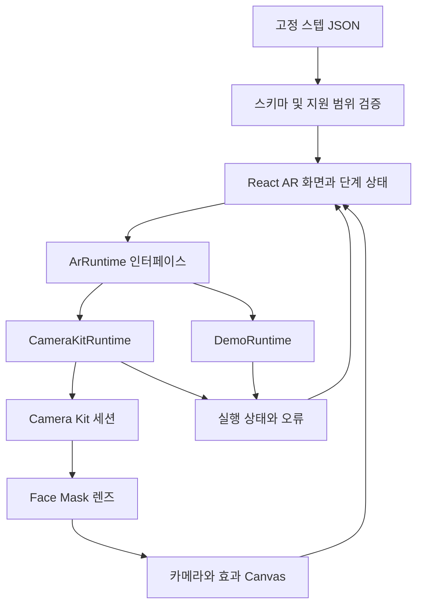

# AI 메이크업 튜터 AR 실행 설계

작성일: 2026-10-31. 상태: 최초 설계. 현재 구현·검증 상태는 `feasibility.md`를 따른다.

첫 목표는 모바일 웹에서 카메라를 켜고, 같은 렌즈에 고정 스텝 3개를 적용하며, 점선 가이드를 켜고 끄는 것이다. 이 경로를 실제 기기로 확인한 뒤 앱 WebView와 메이크업 영역을 확장한다.

## 1. 기준과 현재 상태

- 제품 요구사항: `PRD_AI_Makeup_Tutor_MVP_v0.3.docx`.
- 첫 구현 범위: `AI_Makeup_AR_Agent_Guide.md`.
- 저장소 현황: 문서 2개와 `Eye.png`만 있고, 애플리케이션·패키지 설정·Git 저장소는 없다.
- Camera Kit 접근 권한, Web SDK용 토큰, Lens ID, Lens Group ID, Lens Studio 설치 여부는 미확인이다. 인증 파일이나 사용자 계정은 탐색하지 않았다.
- 문서상의 지원과 실제 실행 성공을 구분한다. 현재 AR·브라우저·WebView 실기기 검증 결과는 없다.

## 2. 첫 구현 범위

| 포함 | 구현 방식 |
| --- | --- |
| 시작 화면 | 사용 목적 설명, 카메라 시작 버튼, 설정 누락 안내 |
| AR 화면 | 전면 카메라, 현재 단계 제목·설명, 이전·다음, 단계 수 |
| 렌즈 1개 | Face Mask로 볼 색상과 강도 표현, 볼 점선 가이드 |
| 고정 스텝 3개 | 동일한 볼 템플릿의 색상·강도·softness를 변경 |
| 가이드 토글 | 현재 스텝의 `guide_on`을 바꾸어 렌즈 재적용 |
| 오류와 재시도 | 권한 거부, 카메라 없음·사용 중, SDK·렌즈 로딩 및 실행 실패 |
| 생명주기 | 종료, 화면 이탈, 백그라운드, 늦게 완료된 초기화의 정리 |
| 개발 확인 | 명시적으로 선택하는 데모 모드, 스텝 JSON 보기·복사 |

로그인, AI 분석, 화장품 관리, 홈 피드, 서버, 공유, 결제, 효과 누적 미리보기는 첫 구현에 넣지 않는다. 강의 데이터 구조와 빈 상태는 유지하고 실제 영상 연결은 권한이 확인된 영상이 생기면 검증한다.

세 스텝은 화장법의 완성된 강의가 아니라 전달값 변경을 확인하는 시험 시나리오다. 한 영역을 먼저 검증하면 여러 영역의 렌즈 제작 문제가 SDK 연동 문제와 섞이지 않는다.

## 3. 기술 선택

| 항목 | 선택 | 이유 |
| --- | --- | --- |
| 웹 | React + TypeScript + Vite | 기존 가이드와 일치하며 단일 화면 PoC에 충분 |
| 스타일 | CSS와 CSS 변수 | 초기 화면에 별도 UI 프레임워크 불필요 |
| 입력 검증 | Zod | 향후 서버 스텝도 같은 경계에서 검증 |
| AR | `@snap/camera-kit` | SDK 의존성을 단일 어댑터로 제한 |
| 화면 상태 | React reducer + 실행부 내부 상태 | 선택한 단계와 실제 적용된 단계를 구분 |
| 테스트 | Vitest, 필요한 화면 동작에 Testing Library | 데이터 경계·비동기 경합·정리 동작 중심 |
| 앱 셸 | 웹 검증 뒤 Capacitor | 현재 React 웹을 감싸는 첫 WebView 시험 경로 |

초기에는 라우터·전역 상태 라이브러리·서버 상태 캐시를 추가하지 않는다. 데모와 실제 AR은 동일한 화면을 사용하고 실행부만 교체한다.

React·Vite·Camera Kit의 정확한 버전은 구현 시작 시 배포 패키지와 로컬 실행 환경을 확인해 고정하고 잠금 파일을 저장한다. 특정 버전의 Lens Studio 호환성은 추정하지 않는다.

## 4. 구성과 데이터 흐름



- **화면**은 단계 선택, 설명, 제품·강의 빈 상태, 오류 표시를 담당한다.
- **스텝 도메인**은 JSON 형식·값·크기 및 지원 템플릿을 검증한다. 메이크업 단계를 추론하거나 새로 생성하지 않는다.
- **실행부**는 카메라, SDK 세션, 렌즈 로딩·재적용·종료를 담당한다.
- **렌즈**는 전달값을 해석하고 얼굴 추적, 효과 및 가이드 표시를 담당한다. React가 얼굴 위에 점선을 그리지 않는다.
- 향후 서버 연동 시 고정 JSON을 받아오는 부분만 API로 교체한다. 앱이 서버의 스텝 생성 규칙을 복제하지 않는다.

### 실행부 인터페이스

다음은 SDK API가 아니라 앱에서 정의할 인터페이스 초안이다.

```ts
type ApplyResult =
  | { status: 'applied'; requestId: number }
  | { status: 'superseded'; requestId: number };

interface ArRuntime {
  start(target: HTMLCanvasElement): Promise<void>;
  applyStep(step: ArStep, guideOn: boolean): Promise<ApplyResult>;
  stop(): Promise<void>;
}
```

실행 중 발생하는 오류는 생성 시 주입하는 상태·오류 콜백으로 전달한다. `ArStep`은 `ar-contract.md`의 계약으로 정의한다. UI에는 Camera Kit 타입을 노출하지 않는다.

`start()`는 같은 실행 중 중복 호출되면 동일한 초기화 작업을 공유한다. `stop()`은 반복 호출해도 안전해야 한다. 종료 후 재시작은 새 실행 세대를 만들고 이전 세대의 완료를 무시한다.

## 5. 화면 설계

모바일 세로 화면을 우선한다. 상단에는 종료 버튼과 `1 / 3` 진행 상태, 중앙에는 카메라 Canvas, 하단에는 단계 설명·가이드 스위치·이전·다음 버튼을 둔다. 기기 안전 영역과 가로 회전 시 높이 변화를 처리한다.

1. **시작 전**: 카메라 사용 목적과 시작 버튼. 실제 AR 설정이 없으면 누락된 설정 이름과 별도의 데모 시작 버튼을 표시한다.
2. **준비 중**: 카메라 권한·SDK·렌즈 준비 상태를 안내한다. 권한 요청 중에는 중복 시작을 막는다.
3. **진행 중**: 현재 적용된 단계의 설명과 효과를 함께 보여준다. 단계 변경 중에는 Canvas 위에 전환 표시를 덮어 오래된 효과를 새 설명과 혼동하지 않게 한다.
4. **완료**: 종료 또는 처음부터 다시 실행. 카메라는 종료 시 해제한다.
5. **오류**: 원인별 안내와 재시도·종료. 권한 거부는 브라우저·앱 설정 안내를 제공하며 자동으로 반복 요청하지 않는다.

데모는 항상 화면에 “데모 · 실제 AR 아님”을 표시한다. 기본은 정적 미리보기로 카메라 권한을 요청하지 않는다. 실제 AR 실패를 데모 성공으로 바꾸지 않는다.

얼굴 이탈 시 효과와 가이드는 렌즈에서 숨긴다. 웹 화면에는 기본적인 얼굴 위치 안내를 제공한다. 얼굴 인식 여부·저조도를 앱이 동적으로 감지하는 것은 SDK 이벤트 또는 별도 통신을 확인한 후 구현하며, 임의의 감지 상태를 만들지 않는다. 렌즈 내부 안내를 먼저 검증하고 PRD의 앱 상태 연동은 별도 미확인 항목으로 기록한다.

## 6. 실행 순서와 상태

주 상태는 `idle → starting → ready → applying → running → stopping → idle`이다. 실패 시 `error`, 백그라운드 진입 시 자원 정리 후 `suspended`로 전이한다. `ready`는 카메라·SDK 준비 완료이며 렌즈 적용 성공을 의미하지 않는다.

### 최초 시작

1. Web SDK 설정, 보안 컨텍스트와 카메라 API 존재 여부를 검사한다.
2. 사용자 시작 버튼으로 전면 카메라를 요청한다. 오디오는 요청하지 않는다. 초기 목표는 720p·30FPS이며 필수 제약으로 강제하지 않는다.
3. Camera Kit 초기화, Canvas를 사용하는 세션 생성, 카메라 source 연결, 렌즈 로딩을 수행한다.
4. 첫 스텝을 적용하고 성공 여부를 확인한 뒤 재생한다.
5. 오류 이벤트를 구독한다. 시작 도중 실패하면 이미 획득한 자원도 정리한다.

모든 `await` 이후 실행 세대가 여전히 유효한지 검사한다. 종료 뒤 늦게 반환된 카메라 스트림은 즉시 트랙을 중지하고, 늦게 생성된 세션은 파괴한다.

### 단계 이동과 가이드 변경

단순히 오래된 Promise의 UI 반영을 무시하는 것만으로는 충분하지 않다. SDK 자체의 렌즈 적용 순서도 제어한다.

- 요청마다 증가하는 번호를 부여한다. 선택한 단계·가이드 상태와 적용 완료된 상태를 따로 저장한다.
- `applyLens`는 한 번에 하나만 실행한다. 진행 중 발생한 요청은 대기 슬롯 하나에 최신 값으로 덮어쓴다.
- 적용 완료 후 더 최신 요청이 있으면 중간 결과를 화면에 공개하지 않고 최신 요청을 적용한다.
- 최신 요청이 성공했을 때만 설명·가이드 스위치·표시 단계를 적용 완료 상태로 확정한다.
- SDK 반환값이 `false`이거나 예외·실행 오류가 발생하면 성공으로 처리하지 않는다. 최신 요청의 실패는 이전 효과를 숨기고 재시도를 제공한다.
- 같은 렌즈를 재적용했을 때 초기화와 새 launch data가 반영되는지는 실기기로 확인한다. 안 되면 `removeLens` 후 재적용을 시험하고 지연·깜빡임을 기록한다.
- 미지원 단계는 이전 렌즈 효과를 제거한 뒤 텍스트·강의 안내만 표시한다.

### 종료와 복귀

- 종료 즉시 실행 세대를 무효화하고, 대기 요청을 비우고, 카메라 트랙을 중지한다. 네트워크·렌즈 적용 완료를 기다리며 카메라를 켜 두지 않는다.
- 진행 중인 SDK 작업과 충돌하지 않도록 같은 실행부에서 세션 정리를 마무리하고 이벤트 구독을 해제한다.
- `pagehide`, 화면 해제, `visibilitychange`의 숨김 상태에서 동일 정리 경로를 사용한다. 네이티브 셸에서는 앱 생명주기 이벤트도 연결한다.
- 복귀 시 단계와 가이드 설정만 보존하고 “카메라 다시 시작” 버튼으로 새 스트림·세션을 만든다.
- React Strict Mode의 마운트·해제 반복에서도 스트림과 세션이 중복으로 남지 않게 한다.

## 7. 렌즈 설계와 제작 경계

첫 렌즈는 Face Mask 기반의 볼 효과 1개와 점선 가이드 1개를 사용한다. 웹과 렌즈가 `BLUSH_APPLE`, `cheek_apple`, `apply` 값을 함께 약속한다. 계약의 세 샘플 모두 이 템플릿을 사용한다.

- 렌즈 시작 시 모든 효과와 가이드를 숨긴 뒤 입력을 검증한다.
- `global.launchParams`는 일반 JSON 객체가 아니라 getter를 제공하는 저장소로 읽는다. 문자열은 `getString`, 수치는 `getFloat`, RGB 배열은 `getFloatArray`를 사용한다.
- 색상은 `[0, 255]` RGB를 재질 색상 범위로 변환한다. 강도와 경계 부드러움은 각각 별도로 표현한다. 단순 투명도 변경을 softness 구현으로 간주하지 않는다.
- softness는 커스텀 재질의 마스크 경계 제어를 우선 시험한다. 필요하면 경계가 다른 텍스처를 사용하고 제한을 기록한다.
- `guide_on=0` 또는 얼굴 미인식이면 가이드를 숨긴다. 효과와 가이드는 같은 얼굴 추적 기준을 사용한다.
- 잘못된 타입·범위·템플릿·가이드 조합은 효과를 숨긴다. 기본 효과를 임의로 표시하지 않는다.
- Lens Studio 미리보기의 샘플 입력은 개발 전용이다. 실제 launch data 전달 성공과 별도로 기록한다.
- `Eye.png`는 볼 검증에 사용하지 않는다. 향후 눈 텍스처로 쓰려면 UV·알파·좌우 방향·깜빡임 품질을 확인해야 한다.

Lens Studio 프로젝트 생성·재질 연결·가이드 텍스처 배치·게시·Lens Group 배정은 별도 제작 작업이다. 코드와 수동 설정 안내를 준비할 수 있으나 실제 편집·게시하지 않은 작업은 완료로 표시하지 않는다.

## 8. 설정과 개발 환경

환경 변수 이름은 `VITE_CAMERA_KIT_API_TOKEN`, `VITE_CAMERA_KIT_LENS_ID`, `VITE_CAMERA_KIT_LENS_GROUP_ID`로 정한다. `.env.example`에는 이름만 넣고 실제 값은 무시되는 `.env.local`에 둔다.

Web SDK 토큰은 클라이언트에서 사용되므로 빌드 결과에서 확인 가능한 값이다. `.env`로 감출 수 있는 서버 비밀키로 취급하지 않는다. 포털의 토큰 종류·사용 origin·허용 설정을 확인하고 적용 가능한 제한을 사용한다. AI·관리용 비밀키를 `VITE_`에 넣지 않는다.

개발 PC의 localhost와 실기기 HTTPS 접근을 구분한다. 모바일에서 PC의 HTTP LAN 주소에 접속하는 방식을 카메라 검증 환경으로 가정하지 않는다. 실기기는 HTTPS 개발 주소와 인증서 신뢰, SDK origin 설정을 확인한다.

SDK가 내려받는 WebAssembly·렌즈 자산의 네트워크 및 CSP 조건을 확인한다. 헤더를 설정할 때 Snap의 공식 CSP 안내를 반영하고 실제 차단 여부를 검증한다.

## 9. 파일 구성안

```text
src/
  app/App.tsx
  app/styles.css
  features/ar/ArTutorPage.tsx
  features/ar/useArTutor.ts
  features/ar/arTutorReducer.ts
  features/ar/components/CameraViewport.tsx
  features/ar/components/StepPanel.tsx
  features/ar/components/ArStatus.tsx
  features/ar/domain/arStep.ts
  features/ar/domain/validateLaunchParams.ts
  features/ar/domain/lensCapabilities.ts
  features/ar/data/pocSteps.json
  features/ar/runtime/ArRuntime.ts
  features/ar/runtime/CameraKitRuntime.ts
  features/ar/runtime/DemoRuntime.ts
  config/env.ts
lens/
  README.md
  scripts/MakeupController.js
  assets/
docs/
  implementation-plan.md
  ar-contract.md
  feasibility.md                  # 구현 시작 시 검증 결과 기록용으로 추가
.env.example
```

테스트는 대상 파일 가까이에 둔다. `lens/`에 스크립트만 있는 상태를 공개된 실행 가능 렌즈로 간주하지 않는다.

## 10. 구현 순서와 완료 조건

| 단계 | 작업 | 완료 조건 |
| --- | --- | --- |
| 1 | React·타입·설정 검증·고정 JSON·데모 화면 | 설정 없이 명시적 데모로 3단계를 이동할 수 있음. 타입 검사·빌드 성공 |
| 2 | 카메라·Camera Kit 어댑터 | 실제 설정으로 시작하고 종료 시 카메라 해제. 거부·실패 후 재시도 가능 |
| 3 | Face Mask 최소 렌즈 제작·연결 | 동일 렌즈에서 3종의 값이 바뀌고 점선이 얼굴에 추종하며 토글 가능 |
| 4 | 모바일 브라우저 시험 | iOS Safari·Android Chrome 개별 기록. 연속 전환·얼굴 이탈·10분 사용 확인 |
| 5 | Capacitor 최소 셸과 WebView 시험 | iOS·Android 권한·origin·재진입·복귀·영상 재생 후 복귀를 별도 판정 |
| 6 | 메이크업 영역 확장 | Makeup Helper 실행 확인 후 립·블러셔·섀도·라인 개별 판정 |

초기 목표는 30FPS, 단계 선택부터 효과 반영까지 0.5초 이내, 10분 중단 없음이다. 공식 보장값이 아닌 잠정 채택 기준으로 사용한다. SDK Promise 소요 시간과 실제 화면 반영은 나누어 측정한다. 측정하지 않은 FPS를 화면 갱신 횟수로 추정해 합격 처리하지 않는다.

### 자동 검증

- 스키마·열거값·수치 범위·UTF-8의 3KB 상한·잘못된 중첩 구조를 검증한다.
- 시작 도중 종료, 늦은 권한 허용, 연속 시작·종료에서도 자원이 남지 않는지 검증한다.
- 연속 단계 변경·가이드 전환 시 SDK 적용이 직렬이며 최종 요청에 수렴하는지 검증한다.
- 최신 적용 실패, `false` 반환, 실행 오류, 미지원 단계에서 이전 효과를 성공 처리하지 않는지 검증한다.

### 실기기 검증

`feasibility.md`에 기기, OS, 브라우저 또는 WebView, SDK·Lens Studio·렌즈 버전, origin, 일시, 결과, 재현 절차를 기록한다. 얼굴 이탈·재인식, 얼굴 회전, 눈 깜빡임, 권한 거부 후 재시도, 화면 재진입, 백그라운드 복귀, 카메라 해제를 확인한다.

WebView가 요구사항을 충족하지 못하면 실패 원인을 구분한 후 AR 화면만 Camera Kit 네이티브 SDK로 분리하는 대안을 검토한다. WebView 성공을 사전에 약속하지 않는다. SDK 상태 변경만으로 얼굴 인식·가이드 품질·렌더링 성공을 증명할 수 없다.

## 11. 선행 확인과 다음 작업

설계 후 바로 진행할 수 있는 작업은 프로젝트 생성, 스키마, 데모, SDK 어댑터, 렌즈 스크립트와 제작 절차 작성이다. 실제 AR 합격 판정에는 Web SDK 접근 권한, 실제 토큰, 게시·배포된 렌즈와 그룹, 시험 기기가 필요하다.

PRD에 남은 사용자 각도·강도 조정 관련 이전 문구는 채택하지 않고 v0.3 상세 요구사항을 따른다. 첫 버전에서 UI로 변경할 수 있는 효과 설정은 가이드 표시뿐이다.

## 12. 공식 자료 확인 메모

다음은 2026-10-31에 확인했다. 문서에 명시된 기능과 이 프로젝트의 실행 검증을 구분한다.

- [Web SDK Setup](https://developers.snap.com/camera-kit/integrate-sdk/web/web-configuration): 초기화, 카메라 source, Canvas, lensRepository, CSP 참고.
- [Launch Data](https://developers.snap.com/camera-kit/integrate-sdk/web/guides/remote-api#launch-data): 수치·문자열과 그 배열, 3KB 상한. Remote API 자체는 채택하지 않는다.
- [CameraKitSession v1.21.0](https://developers.snap.com/reference/CameraKit/web/1.21.0/classes/CameraKitSession.html): 적용 결과 `Promise<boolean>`, 실행 중 오류, `destroy()` 확인. 참조 페이지 버전이며 채택 버전은 미확정이다.
- [Lens Studio Compatibility](https://developers.snap.com/camera-kit/ar-content/lens-studio-compatibility): 확인 시 표는 Web 1.14.x와 Lens Studio 5.18.x까지 기재해, 위 1.21.0의 대응 버전을 표에서 결정할 수 없다. 채택 SDK 배포 정보·공식 변경 이력·실제 렌즈로 확인해 고정한다.
- [Face Mask](https://developers.snap.com/lens-studio/features/ar-tracking/face/face-mask): Camera Kit 지원 표기와 2D 텍스처·얼굴 추종 참고.
- [Launch parameter access](https://developers.snap.com/lens-studio/publishing/distributing/snap-kit): `global.launchParams` getter와 개발용 fallback 참고.
- [Capacitor](https://capacitorjs.com/docs): 같은 웹 코드를 감싸는 후보이며 Camera Kit WebView 동작 보장의 근거로 사용하지 않는다.

설정 페이지와 API 참조에는 `createSession`이나 카메라 종류 등 예제의 차이도 있다. 구현 시 채택 패키지의 타입과 대응 참조를 대조하고 예제 복사만으로 API를 결정하지 않는다.
